  

<h1 align="center">Hi 👋, I'm Enes 🔹</h1>

  

  <i>"Life is not a problem to be solved, but a reality to be experienced."</i>

  
  
  

---

## 🌙 Now on the App Store: Mizan

  

<h3 align="center">A prayer companion that asks nothing of you.</h3>

<b>Free · No account · Built for you</b>

  
  

  

My first app live on the App Store, built from the ground up and released in September 2026.

- 🕌 Shows the prayer you are **in right now**, not just the next one, with every prayer's window and the karahat times
- 🧮 **22 calculation methods** plus custom angles, both Asr madhhabs and high-latitude rules, with your region's authority picked automatically
- 📖 Full **Qur'an reader** with recitation audio, a **Qibla** compass, **Tasbih**, a **Prayer Log** and **Prayer Lock**
- 🔒 Everything stays on the device: no account, no ads, no analytics, no backend
- 🇬🇧 🇹🇷 English and Türkçe · iPhone + Apple Watch · **Android version in testing on Google Play**

  
  
  
  
  
  

---

## 👨‍💻 About Me

- 🎓 CS student @ **UTM**
- 🌸 Founder of **Shinka**, where I build and ship my own apps. Mizan is the first one live
- 🏪 Building **Demola**, a platform for local GTA business websites, built before the pitch
- 📱 **SwiftUI** for iOS and watchOS, **Kotlin + Compose** for Android, **Flutter**, **React Native** and **Next.js**
- 🤖 Agentic engineering: multi-agent build pipelines, custom skills, MCP servers and Telegram bot automations
- 🐧 Arch Linux + Hyprland, terminal-first

---

## 🛠️ Building Now

<table>
<tr>
<td width="50%" valign="top">

### 🏪 Demola
Websites for local GTA businesses. It studies a business and its competitors, builds the new site first, then pitches it. First clients signed.

React · Vite · Supabase · Playwright

</td>
<td width="50%" valign="top">

### 🤖 Butler
A chief of staff on my iPhone. Every coding session on my Mac, its decisions and its live activity, steered from my phone while the Mac stays home.

SwiftUI · Node · Tailscale

</td>
</tr>
<tr>
<td width="50%" valign="top">

### 🏡 Yuva
A home listings app for Toronto's Turkish community, with separate sides for home-seekers and realtors. Client project, in Turkish and English.

Expo · React Native · Next.js · Supabase

</td>
<td width="50%" valign="top">

### 🏠 Uchi
My personal home base: family lists, bills and chores, plus study rooms with a built-in tutor, a code room and books.

SwiftUI · Supabase

</td>
</tr>
<tr>
<td colspan="2" valign="top">

### 📱 Mizan for Android
The full Mizan experience on Android, matched screen for screen with iOS, including real app blocking in Prayer Lock.

Kotlin · Jetpack Compose

</td>
</tr>
</table>

---

## 🌸 Shinka Apps

| | App | What it is | Stack |
|:-:|---|---|---|
|  | **MoshiMosh** | Japanese learning with mini-games, weekly leagues and real-time chat | Flutter · Supabase · RevenueCat |
|  | **Pocket** | Finance dashboard for indie makers: budgets, revenue, socials and an AI advisor | React Native · Expo · Supabase |
|  | **GymVro** | Fitness companion: workouts, food, streaks and squads. New look in progress | Flutter · Firebase |
|  | **Snag** | Self-hosted media downloader to my Mac, Google Drive or SFTP, behind 2FA | FastAPI · React · Cloudflare Tunnel |
|  | [**shinka.ca**](https://shinka.ca) | The Shinka site: Mizan's home, legal pages for every app | Next.js · GSAP · Cloudflare Pages |

---

## 🧪 On the Bench

- 🕶️ **Immersa** · turns Insta360 360° shots into virtual tours you can walk through (SwiftUI + SceneKit)
- 📸 **Lumette** · a disposable camera for events: guests scan a QR, nobody sees the photos until the host reveals the album
- 🥗 **Savor** · a calorie tracker you just talk to
- 🚗 **DriveTalk** · hands-free voice control of my coding sessions from the car
- 👷 **Foreman** · construction project management for iOS: crew, costs, receipt OCR and reports
- 🎬 **Jarvis** · clips and music in, a beat-synced captioned 9:16 short out
- 📜 **ytread** · paste a YouTube link, get a readable transcript

---

## 🧰 Tech Stack

### 🔹 Languages

  
  
  
  
  
  
  

### 🔹 Mobile

  
  
  
  
  
  
  

### 🔹 Frontend

  
  
  
  
  
  
  

### 🔹 Backend & Data

  
  
  
  
  
  

### 🔹 DevOps & Tools

  
  
  
  
  
  
  

### 🔹 AI & Automation
- Agentic engineering with **Claude Code** + the **Anthropic SDK**: multi-agent fleets, custom skills, and **MCP** servers (including a code-graph memory indexed over my repos)
- A small **Telegram bot fleet** for idea capture and tool discovery: deterministic Python transports, LLM brains
- Voice generation via **ElevenLabs** with content-addressable audio hosting on **Cloudflare R2**
- Local-first LLM workflows with self-hosted **Ollama**

---

## 🐍 Watch the snake eat my contributions

<picture>
  <source media="(prefers-color-scheme: dark)" srcset="https://raw.githubusercontent.com/KaosFish/KaosFish/output/github-contribution-grid-snake-dark.svg"/>
  <source media="(prefers-color-scheme: light)" srcset="https://raw.githubusercontent.com/KaosFish/KaosFish/output/github-contribution-grid-snake.svg"/>
  
</picture>

---

  <b>My system after <code>rm -rf</code></b> 
  

